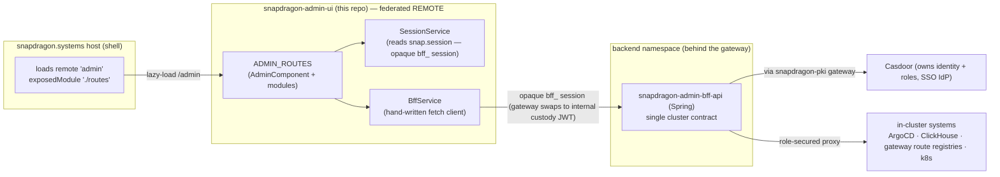
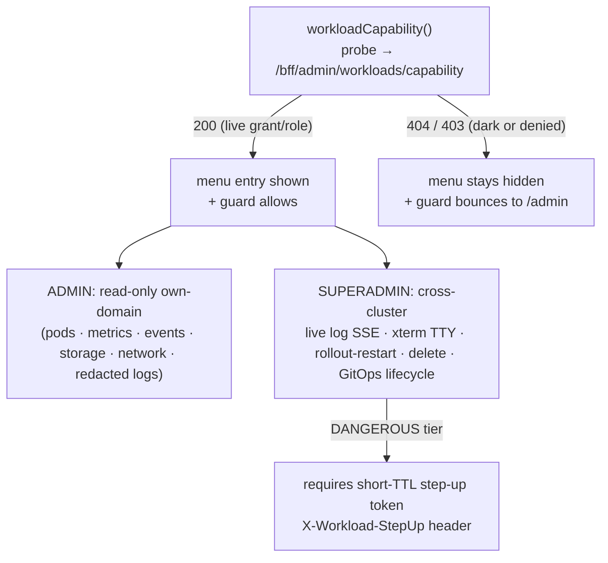

# snapdragon-admin-ui

Admin console for the Snapdragon platform, built as an **Angular 22
native-federation REMOTE** (federation remote name `admin`), split out of
snapdragon-social-ui. The **snapdragon.systems host** federates this remote's
single exposed `./routes` module at runtime and mounts the exposed
`ADMIN_ROUTES` at **/admin**.

## Where it sits in the architecture

| Concern        | This repo                                                              |
| -------------- | --------------------------------------------------------------------- |
| Tier           | Frontend / micro-frontend (a federated **remote**, not a host)        |
| Namespace      | `snapdragon-frontend` — runs as its own nginx pod                     |
| Fronted by     | the **fe-gateway** at `/admin`                                         |
| Backed by      | **snapdragon-admin-bff-api** (Spring), in the backend namespace, behind the gateway |
| Auth model     | Casdoor **admin role** for most routes; **superadmin role** for the superadmin-only routes; the host route-guards `/admin` |
| Federation host| **snapdragon.systems** (loads `remoteName: 'admin', exposedModule: './routes'`) |



> The diagram shows the **shipped** wiring. Roles are **owned by Casdoor**; this UI
> never mints or evaluates authority on its own — it only reflects the
> `snap.session` roles and lets the BFF/gateway enforce. See the **Roadmap** section
> for surfaces that are designed/in-flight but not yet shipped here.

This is the admin surface of the multi-brand / multi-tenant platform. It is a
*consumer-facing UI only*: every privileged action is brokered by the admin BFF,
which is the single contract to the cluster. The BFF in turn reaches **Casdoor
through the snapdragon-pki gateway** for identity/role operations and proxies
in-cluster systems (ArgoCD, ClickHouse, the gateway route registries) so their
URLs/tokens never leave the cluster. Roles are **owned by Casdoor**; this UI
never mints or evaluates authority on its own — it only reflects the
`snap.session` roles and lets the BFF/gateway enforce.

> Multi-tenancy note: in the platform direction (per-domain CA + per-brand
> gateway/BFF/UI instances + issuer-keyed domain scoping + the least-privilege
> cascade SUPERADMIN→ADMIN→MOD→USER), this console is the **per-brand ADMIN
> surface**. As shipped today (✅) the base gate is a Casdoor `admin` role
> (`roles.includes('admin')`), and a handful of routes additionally require the
> Casdoor `superadmin` role (`SuperadminGuard`); two routes ride the games-services
> derived roles. **Domain scoping is still enforced upstream at the gateway/BFF**
> (the BFF stamps/scopes each call to the caller's domain), not in this UI — the
> client-side role flags are presentation-only and the BFF/gateway is the authority.

> State convention used below: **✅ shipped** = merged to `main`;
> **🚧 in-flight** = code on an open branch/PR; **🔭 planned** = design-complete, no
> code in this repo. Unless marked otherwise, everything documented here is ✅ shipped.

## Current State

The whole route surface, role gate, and BFF contract documented in this README are
**✅ shipped on `main`** (Angular 22 native-federation remote, exposed `./routes`).
No auth-relevant work is sitting unmerged on a side branch — every prior
auth/route/oidc/delegation branch has landed (or was a superseded draft fully
absorbed into `main`).

The one place this UI is **deliberately tracking a moving backend** is the auth /
session bridge, recently unified across the platform:

- **SSO is Casdoor (OIDC authorization-code + PKCE).** The `login-ui` remote runs
  the Casdoor redirect; **`snapdragon-user-bff` does the server-side
  code→token exchange and holds per-session JWT custody/refresh.** The browser
  only ever holds an **opaque `bff_`-prefixed session** (the `snap.session`
  payload). **The user never sees their own Casdoor JWT.**
- **The gateway is a pure Casdoor-JWT OAuth2 resource server.** A pre-security
  exchange filter swaps the opaque `bff_` session → the internal custody JWT, so
  the gateway's JWT validation + role gate run unchanged. Authorization is
  data-driven by the `gateway_route_access` Postgres table (source of truth) via
  `GatewayRouteAccessFilter`; ADMIN/GAME-MASTER bypass within their own domain,
  SUPERADMIN cross-domain. The SCG-5 route-namespace move
  (`spring.cloud.gateway.routes` → `spring.cloud.gateway.server.webflux.routes`)
  is already applied across the gateways + generator route templates. Cloudflare
  fronts prod.
- **Login / session / account logic is being RELOCATED from admin-bff to
  user-bff**, with the shared account/session/MFA/Casdoor-admin infra extracted
  into the new **`snapdragon-auth-core`** Maven artifact (2.3.0, consumed by
  user-bff + admin-bff only). **Account / session DATA still lives in
  admin-bff-db**; user-bff reaches it via admin-bff `/bff/internal` over
  mTLS + `X-Internal-Token`.
- Backend baseline (recently unified): **Spring Boot 4.0.7 / Spring Cloud
  2025.1.2 / Java 25 LTS**, on `snapdragon-parent` (metapom 2.7.0) +
  `snapdragon-commons` (2.0.0).

> Implication for this UI: `snap.session.bffToken` is the **opaque `bff_` session
> handle**, not a raw Casdoor JWT — the gateway performs the `bff_`→JWT swap.
> `BffService` continues to attach it on every call; the registration / login /
> service-token broker flow lives in the **login remote** (now backed by user-bff),
> not here.

## Routes (mounted by the host at `/admin`)

The remote exposes `ADMIN_ROUTES` (`src/app/admin.routes.ts`). The host mounts
them at `/admin`, so they resolve to the paths below. The **Guard** column is the
route-level `canActivate` (none = host/admin-guarded only); the **Menu** column is
whether `AdminComponent`'s nav surfaces the route as a `routerLink`. All of these
are ✅ shipped on `main`.

| Host path                 | View                                                | Component                   | Guard            | Menu |
| ------------------------- | --------------------------------------------------- | --------------------------- | ---------------- | ---- |
| `/admin`                  | Registration allowlist + admin menu                 | `AdminComponent`            | —                | (landing) |
| `/admin/usage`            | ClickHouse usage dashboard                          | `UsageComponent`            | —                | yes  |
| `/admin/namespaces`       | Namespace access grants                             | `NamespaceAccessComponent`  | —                | yes  |
| `/admin/delegation`       | Access-role suspend/ban + lift, domain-lock add/remove | `DelegationComponent`    | —                | yes  |
| `/admin/route-access`     | Per-gateway role→URL access rules                   | `RouteAccessComponent`      | —                | yes  |
| `/admin/routes`           | Gateway route definitions                           | `RouteDefinitionsComponent` | —                | yes  |
| `/admin/isos`             | CI ISO download links                               | `IsoDownloadsComponent`     | —                | yes  |
| `/admin/argocd`           | ArgoCD applications dashboard                        | `ArgocdDashboardComponent`  | —                | yes  |
| `/admin/tasks`            | Guided admin-task wizard                             | `AdminTaskWizardComponent`  | —                | yes  |
| `/admin/backup`           | Start a cloud/USB backup                            | `BackupComponent`           | —                | yes  |
| `/admin/recovery`         | Restore a backup                                    | `RecoveryComponent`         | —                | yes  |
| `/admin/backups`          | Backup + restore history                            | `BackupHistoryComponent`    | —                | yes  |
| `/admin/cloud-backups`    | Cloud backups (per-domain + superadmin TOTAL, versioned, step-up restore) | `CloudBackupsComponent` | —          | yes  |
| `/admin/announcements`    | Announcements (create + schedule + target)          | `AnnouncementListComponent` | —                | yes  |
| `/admin/test-reports`     | Test-architecture run history + on-demand run + download | `TestReportsComponent` | —                | yes  |
| `/admin/image-gen`        | Image-generation console (trigger / SSE progress / download, capability-gated) | `ImageGenComponent` | —          | yes  |
| `/admin/forum`            | Forum (phpBB ACP) admin proxy                       | `ForumAdminComponent`       | —                | yes  |
| `/admin/appeals`          | Appeals-Decide console (decide-proxy, domain-scoped) | `AppealsComponent`         | —                | yes  |
| `/admin/device-licenses`  | Device-ownership / SSH-operate-license registry      | `DeviceLicensesComponent`   | `superadminGuard` | superadmin-only |
| `/admin/device-pending`   | Pending headscale-node pick-list (assign into registry) | `DevicePendingComponent` | `superadminGuard` | superadmin-only |
| `/admin/node-storage`     | Attach + register additional node-pinned storage     | `StoragePoolsComponent`     | —                | yes  |
| `/admin/desktop`          | Desktop governance (Discover curation, sudo toggle, install inbox, remote-install + SSH terminal) | `DesktopGovernanceComponent` | —    | yes  |
| `/admin/egress-vpn`       | Import provider WireGuard/OpenVPN egress configs     | `EgressVpnComponent`        | `superadminGuard` | superadmin-only |
| `/admin/superadmin/domains` | Domain-registry (brand list) console + per-row provisioning-state chip | `SuperadminDomainsComponent`| `superadminGuard` | superadmin-only |
| `/admin/oidc-providers`   | Per-OIDC-provider default-role mappings              | `OidcProviderRolesComponent`| —                | no (route-only) |
| `/admin/games-services`   | Games app-store operator console                     | `GamesServicesComponent`    | `gamesServicesGuard` | no (route-only) |
| `/admin/superadmin/anubis`| Anubis PoW sidecar status + metrics (read-only)      | `AnubisAdminComponent`      | `superadminGuard` | no (route-only) |
| `/admin/workloads`        | Workload Console (HIDDEN tier — pod mgmt)            | `WorkloadConsoleComponent`  | `workloadConsoleGuard` | hidden (capability-probe) |
| `/admin/workloads/logs`   | Workload live-log view (SUPERADMIN)                  | `WorkloadLogsComponent`     | `workloadConsoleGuard` | hidden |
| `/admin/workloads/terminal` | Workload pod TTY (SUPERADMIN, xterm.js)            | `WorkloadTerminalComponent` | `workloadConsoleGuard` | hidden |

`AdminComponent` is both the landing view (registration allowlist) and the admin
**menu**. The menu does **not** auto-surface every route: superadmin-only items
appear only when the session carries the `superadmin` role (defence-in-depth — the
route is `superadminGuard`ed too); the Workload Console is **HIDDEN tier** and
appears only when a server-confirmed capability probe (`/bff/admin/workloads/capability`,
200 = live grant/role, 404 = dark/denied) passes; and a few routes
(`/admin/oidc-providers`, `/admin/games-services`, `/admin/superadmin/anubis`) are
reachable by direct navigation / cross-links rather than a top-level menu entry.

## Role gate & session

The base gate is the Casdoor **admin role**; the host route-guards `/admin`. This
repo ships four `CanActivateFn` guards, each reading `SessionService` role flags
(all client-side checks are **presentation-only** — the BFF/gateway is the
authority):

| Guard                  | File                          | Allows when                                                                 | Guards |
| ---------------------- | ----------------------------- | --------------------------------------------------------------------------- | ------ |
| `adminGuard`           | `src/app/admin.guard.ts`      | `isAdmin()` (`roles` includes `admin`), else `/login`                        | standalone admin gate |
| `superadminGuard`      | `src/app/superadmin.guard.ts` | `isSuperadmin()` (`roles` includes `superadmin`), else `/login`              | device-licenses, device-pending, egress-vpn, superadmin/domains, superadmin/anubis |
| `gamesServicesGuard`   | `src/app/games-services.guard.ts` | `isGamesServicesAdmin()` **or** `isGamesServicesRunner()`, else `/login`  | games-services |
| `workloadConsoleGuard` | `src/app/workload-console.guard.ts` | admin/superadmin **and** a live server-confirmed `workloadCapability()` probe (200); else bounced to `/admin` | workloads + workloads/logs + workloads/terminal |

`SessionService` (`src/app/session.service.ts`) reads the shared **`snap.session`**
localStorage key written by the **login remote** (identity, `roles`, `bffToken`,
`registrationComplete`, optional Matrix/Mastodon tokens). **`bffToken` is the
opaque `bff_`-prefixed session handle — not a raw Casdoor JWT;** the gateway swaps
it for the internal custody JWT on the way in (the user never sees their JWT). The
login/registration flow that writes this key is owned by the login remote (now
backed by `snapdragon-user-bff`, which holds the per-session JWT custody). It
exposes the role state as **computed signals** — `isAdmin`, `isSuperadmin`, plus
the games-services derived roles `isGamesServicesAdmin` / `isGamesServicesRunner`
(materialized in Casdoor and surfaced lowercased, `ROLE_`-prefix-stripped, in
`session.roles`) — and `fullyRegistered` (the registration-complete gate). The
host shell and each remote hold their own `SessionService` instance over the same
key and re-read on a same-document broadcast (`snap-session-change`) and cross-tab
`storage` events, so a session change (e.g. registration completing in the login
remote) propagates without a reload.

## BFF contract

`BffService` (`src/app/bff.service.ts`) is the hand-written typed client against
**snapdragon-admin-bff-api**. Every call attaches the opaque session handle
(`authorization: Bearer ${snap.session.bffToken}` — a `bff_` session, swapped to
the internal Casdoor custody JWT by the gateway) and targets the admin-scoped (and
a few superadmin-scoped) endpoints — the registration/login/Matrix-Mastodon
service-token broker flow lives in the login remote (backed by user-bff). The BFF
URL + Uptrace URL are read from runtime globals (`__SNAP_BFF_URL__`,
`__SNAP_UPTRACE_URL__`). SSE streams (backup/restore progress, test-run progress,
live workload logs) are read with a bearer `fetch` + `ReadableStream` reader rather
than raw `EventSource`, so the session handle can be sent.

| Module                  | Endpoint(s)                                                | Notes |
| ----------------------- | ---------------------------------------------------------- | ----- |
| Registration allowlist  | `GET/POST /bff/admin/allowlist`                            | Invite by Gmail address or Discord username; the BFF invites the identity in Casdoor via the pki gateway. |
| Usage analytics         | `GET /bff/admin/usage` (+ Uptrace link)                    | Aggregated by the BFF from ClickHouse (events arrive via Kafka in prod). |
| Namespace access        | `GET/POST/DELETE /bff/admin/namespace-access`, `GET /bff/me/namespaces` | Grant users access to cluster namespaces (maps to Casdoor groups + k8s RBAC server-side); scopes what each user sees in observability. |
| Route **access**        | `GET/POST/DELETE /bff/admin/route-access`                 | Per-gateway role→URL allow/deny rules. Persisted in Postgres (`gateway_route_access`, the gateway's source of truth via `GatewayRouteAccessFilter`); each gateway caches them and denies external access unless the caller's Casdoor roles match. Role-based locking of known services only — no arbitrary URLs. |
| Route **definitions**   | `GET/POST /bff/admin/routes`, `DELETE /bff/admin/routes/{pathPrefix}` | Admin-editable `url_registry` rows the gateway turns into live Spring Cloud Gateway routes (`path_prefix` → `downstream_uri`, under the SCG-5 `spring.cloud.gateway.server.webflux.routes` namespace). Distinct from route-access. |
| ISO downloads           | `GET /bff/admin/isos`                                      | Latest ISO artifacts from the GitLab/ArgoCD CI pipeline. Signed gateway-internal URLs; **KEYS material is never in these images**, so nothing secret is exposed. |
| ArgoCD dashboard        | `GET /bff/admin/argocd/applications[/{name}]`, `POST .../sync` | Role-secured proxy in the BFF (ArgoCD's own URL/token never leave the cluster). Live state; the sync mutation requires a typed `{confirm: name}` token. When ArgoCD is not wired the BFF returns `503` → an honest "ArgoCD not connected" notice. |
| Guided tasks            | `GET /bff/admin/tasks`, `POST .../steps/{stepId}/{validate\|preview\|apply}` | Data-driven step/task wizard over cluster-admin ops (gateway-route, RBAC/route-access, Casdoor user); a new server-side task appears with no UI change. Reuses the BFF's ReservedNames validation. |
| Backup & Recovery       | `POST /bff/admin/backups`, `POST /bff/admin/restores`, `GET /bff/admin/backups`, `GET /bff/admin/usb-devices`, SSE `GET /bff/admin/backups/{id}/events` | Cloud/USB targets with optional AES-256 encryption. The BFF orchestrates a k8s backup/restore worker Job and streams progress over SSE (read via `fetch`, not `EventSource`, so the bearer token can be sent). The plaintext password is sent ONCE and never stored client-side; only the BFF stores a PBKDF2 verifier and the worker derives the key. |
| Announcements           | `GET/POST/PUT/DELETE /bff/admin/announcements`             | See below. |
| Delegation / access-roles | `GET/POST/DELETE /bff/admin/access-roles/{role}/{user}`, `GET/POST/DELETE /bff/admin/domain-lock/{role}/{user}` | The narrow, AdminController-verified delegation surface: access-role suspend/ban (+ TTL or permanent) + lift, and domain-lock add/remove (force local-only, keeps the base role). Closed role vocabularies (`ROLE_MATRIX`/`ROLE_MASTODON`/`PROFILE`; `*_DOMAINLOCKED`). No general role grant/revoke exists. |
| Appeals (decide-proxy)  | `POST /bff/admin/moderation/{id}/decide?approve=<bool>`    | Approve/deny a referred moderation request. The admin-bff does NOT own the table — it **proxies** to snapdragon-federation-api, forwarding the caller's JWT so federation-api applies its own `@PreAuthorize(ADMIN\|SUPERADMIN)` + **per-domain scope** (a row in another brand is invisible/404). No list endpoint yet — the console drives the decide action by known id. |
| Forum admin             | `GET/POST/DELETE /bff/admin/forum/**`                      | Proxies the phpBB ACP capability (stats/usage/users/categories/moderation-queue/audit + ban/groups/categories/moderation approve-reject/styles/extensions). Every response is the `ForumOutcome` envelope with a `result` marker (`ok` / `stubbed` / `degraded:<reason>`). |
| Test reports            | `GET /bff/admin/test-reports[/{id}]`, `GET .../{id}/download`, `POST .../run`, SSE `GET .../{id}/events` | Durable test-architecture run history + on-demand trigger + bearer-gated `tar.gz` download + live SSE progress. |
| Device licenses         | `GET /bff/admin/device-licenses`, `POST .../{id}/grant`, `POST .../domains/{domain}/grant`, `DELETE .../licenses/{id}` | **Superadmin**: the source of truth for device ownership / domain-residency / SSH operate-licenses. List is admin-readable (own-domain, BFF-scoped); every mutation is `hasRole('SUPERADMIN')`. Grants pin SSH key fingerprints; revoke is a CAS flip (never a delete). |
| Device pending pick-list| `GET /bff/admin/device-licenses/pending`, `POST .../register` | **Superadmin**: assign a headscale-enrolled node into the registry. `machineKeyFp` is an **opaque** token from headscale — never typed/edited; the BFF re-validates it against headscale at register. |
| Node storage            | `GET /bff/admin/device-storage-pools`, `POST .../{deviceId}/pools`, `DELETE .../pools/{poolId}`, `POST .../pools/{poolId}/assignments`, `DELETE .../assignments/{id}` | **Admin-capable** (deliberate divergence from device-licenses) but **ownership-gated** downstream: an admin acts only on own-domain admin-owned nodes (403 on deny); superadmin-owned nodes are superadmin-only. Attach node-pinned storage + assign services (capacity-aware; over-subscription → 422). |
| Egress VPN              | `GET /bff/admin/egress-vpn`, `POST .../configs`, `DELETE .../configs/{id}`, `POST .../configs/{id}/assign/{node\|domain}/{id}`, `DELETE .../assignments/{id}` | **Superadmin** mutations: import provider WireGuard/OpenVPN configs that nodes use for **outgoing** public egress. The `.conf` text is sent for parse-validation only — the BFF stores a `secret_ref` + metadata, never the private key (secrets off-DB / off-git). |
| Domains (registry)      | `GET /bff/admin/domains[/{clusterDomain}]`, `POST /bff/admin/domains`, `PUT /bff/admin/domains/{clusterDomain}` | **Superadmin** (every endpoint): the runtime brand/domain registry (multi-tenancy PR9), the managed twin of the build-time `domains.conf`. No hard delete — soft-disable via `PUT enabled:false`; duplicate `cluster_domain` → 409. `caRef` is a CA *reference*, never key bytes. Each list row carries three `DomainResponse` provisioning-status fields (`caProvisioned` / `appsetRegistered` / `lastReconciledGeneration`, admin-bff #118) the console renders as a per-row chip: `isProvisioned()` = `caProvisioned && appsetRegistered` ⇒ a subtle "Provisioned" state, else a greyed/degraded "Registered — not yet provisioned" chip + helptext. The fields ship dark (default false until the generator domain-reconcile effector flips them), so at rest every freshly-registered domain reads not-yet-provisioned — the honest current state. Pure presentational (no new BFF call); colour is never the only signal (visible text + `.sr` prefix + `aria-label` + `aria-describedby`, `aria-disabled` on the degraded variant). |
| OIDC provider roles     | `GET /bff/admin/oidc-providers/roles`, `PUT/DELETE /bff/admin/oidc-providers/{provider}/roles` | Configure which roles new users auto-receive when first registering via a given OIDC identity provider. Domain-scoped for admins, all-domains for superadmin (BFF-enforced). |
| Games app-store         | `GET /bff/games-services/catalog`, `GET/POST /bff/games-services/instances`, `POST .../instances/{id}/{suspend\|resume\|terminate}` | Games-services control plane: browse the offered+enabled catalog and create/run/stop dockerized FOSS game-server instances. Authz is the games-services derived roles + domain scope at the BFF; the console greys out create for a runner. |
| Anubis (read-only)      | `GET /bff/admin/anubis/status`, `GET /bff/admin/anubis/metrics`            | **Superadmin** read-only: Anubis PoW challenge-sidecar status + configured settings + proxied Prometheus metrics. Settings are from the BFF's own config (changing them needs an ArgoCD deployment update), not from the Anubis runtime. |
| Workload Console        | `GET /bff/admin/workloads/capability`, `GET /bff/admin/workloads/**` (read, admin own-domain), `GET/POST/DELETE/PUT /bff/superadmin/workloads/**` (superadmin) | HIDDEN-tier. The whole surface 404s when dark (generator gate off / DB master flag off / no active grant). Admins get read-only own-domain (grant-gated); superadmin gets cross-cluster view + log stream + TTY + rollout-restart / delete / GitOps lifecycle intents (DANGEROUS tier requires a short-TTL step-up token in `X-Workload-StepUp`) + grant/config control plane. See below. |

## Announcements

`/admin/announcements` creates, schedules and targets announcements via the admin
BFF (`/bff/admin/announcements`, ROLE_ADMIN). An announcement carries a
`body_html` (HTML / WYSIWYG), a `state` (draft / published / archived), a schedule
(`starts_at` / `ends_at` / `timezone`), a `priority`, a `dismissible` flag and
**four per-surface target flags** so one announcement can show on any combination
of the logged-in **Home** top banner, the public **Login** page (everyone, incl.
anonymous), **Mastodon/akkoma** (as a local-only admin announcement, propagated by
the BFF on publish) and the **Forum** main page. The per-surface read endpoints
(`/bff/announcements/home`, `/bff/public/announcements/login`,
`/bff/announcements/forum`) live in the BFF and apply the authoritative ACTIVE
rule; this UI computes an "active now" badge client-side for display only.

`body_html` is admin HTML shown to end users (including anonymous login visitors),
so it is **sanitised server-side by the BFF** (the authority) and the editor
**never uses raw `innerHTML`**: the live preview renders the sanitised body inside
a **sandboxed null-origin `srcdoc` iframe** (`sandbox=""` — no `allow-scripts`, no
`allow-same-origin`), mirroring the snapdragon-user-ui card-builder two-wall model.
`AnnouncementsStore` is the signal-backed typed client. Note (✅):
`ng-openapi-gen` **is** wired AND the generated client **is committed** to
`src/app/api/` (see *OpenAPI client generation* below). `AnnouncementsStore` is
the **first module migrated onto the generated client** — it calls the generated
`AnnouncementAdminControllerService` and reuses the generated `Announcement` /
`AnnouncementRequest` models. The remaining catch-all client (`BffService`) is
still hand-written against the shared API contract pending its own migration.

## Workload Console (HIDDEN tier) ✅

`/admin/workloads` is a podman/OpenShift-equivalent pod-management module. It is
**registered but never auto-surfaced**: the menu entry and the `workloadConsoleGuard`
both read a single server-confirmed truth — the `workloadCapability()` probe, which
returns `200` with a capability body iff the caller has a live grant/role and `404`
on deny (no existence leak). When the feature is dark (generator gate off / DB master
flag off / no active grant) the whole surface 404s.



Tiering matches the BFF: admins read `/bff/admin/workloads/**` (read-only,
own-domain, grant-gated); superadmins reach `/bff/superadmin/workloads/**` for the
mutating/dangerous surfaces. The live log stream is SSE (bearer `fetch`); the pod
TTY uses `@xterm/xterm`.

## OpenAPI client generation ✅ (wired + committed)

`ng-openapi-gen` is a devDependency and **is wired**: `npm run gen:spec` copies the
admin BFF's committed OpenAPI spec (`../snapdragon-admin-bff-api/.../openapi.json`,
overridable via `ADMIN_BFF_SPEC`) to `openapi.json`, and `npm run gen` regenerates a
typed client into `src/app/api/` (config in `ng-openapi-gen.json`). The generated
output **is committed** to `src/app/api/` (per-controller services + models). The
first consumer migrated onto it is `AnnouncementsStore`
(`AnnouncementAdminControllerService` + generated models); the catch-all
`BffService` remains hand-written against the shared API contract pending its own
migration onto the generated client.

## Accessibility

Every module follows the platform a11y baseline: inline validation surfaced in
`role=alert` live regions, async progress announced via `role=status` /
`aria-live`, status conveyed with text (not colour alone), `<label for>` on every
field, confirm-before-destructive guards, and keyboard-operable controls
(the ArgoCD sync confirm is a focus-managed `role=dialog aria-modal`). The
standalone dev shell supplies a skip link + a `<main id="main">` landmark.

## Federation

`federation.config.js` (built via `federation-base.js`, the shared Snapdragon
federation surface) exposes `./routes` → `src/app/admin.routes.ts`
(`ADMIN_ROUTES`). The remote name `admin` and the exposed module key `./routes`
**must stay unchanged** or the host's admin console breaks. The build emits
`dist/admin/browser/remoteEntry.json`, whose `exposes` entry the host consumes to
lazy-load the routes.

## Develop

```bash
npm install
npm start            # ng serve admin → http://localhost:4204 (standalone dev shell)
```

The standalone dev shell (`AppComponent`, selector `snap-admin-root`) mounts
`ADMIN_ROUTES` at `/` so the remote is browsable on its own. In production the
host loads `./routes` directly and this shell is not used.

## Build

```bash
npm run build        # ng build admin
```

The Angular application builder nests output under **`dist/admin/browser/`**
(incl. `remoteEntry.json`).

## Test

```bash
npm test             # ng test admin --watch=false --browsers=ChromeHeadlessCI
```

In CI this runs as the `test` stage (a `node:24-alpine` + chromium container,
emitting JUnit via `karma-junit-reporter`) and **gates** the image build — see
*Deploy*.

## Deploy

`Dockerfile` builds the remote and serves `dist/admin/browser` via nginx with
`Access-Control-Allow-Origin "*"` (so the host can fetch `remoteEntry.json` and
chunks cross-origin) and an SPA fallback to `/index.html`; `GET /healthz` returns
`200`. The nginx config also emits the baseline security-header set on every
response (`always`): `X-Content-Type-Options: nosniff`, `X-Frame-Options: DENY`,
`Referrer-Policy: strict-origin-when-cross-origin`, and `Strict-Transport-Security`
(HSTS, 1y + `includeSubDomains`). Stricter policies (CSP, COEP/CORP,
Permissions-Policy) are deliberately deferred pending per-UI tuning + live-cluster
browser validation. Runs as its own pod in the **snapdragon-frontend** namespace,
fronted by the **fe-gateway** at `/admin`.

CI (`.gitlab-ci.yml`) runs **three stages** on push / mirror-sync (CI is **GitLab**
across the platform — there are no GitHub Actions):

1. `test` — `ng test` in a `node:24-alpine` + chromium container, emitting JUnit
   reports (`karma-junit-reporter`).
2. `build` — `build:image` (`needs: [test]`, so the image build/push only proceeds
   after tests pass) builds + pushes the image to the in-cluster GitLab registry,
   tagged with the release tag / git SHA plus a moving branch tag.
3. `pentest` — the centralized OWASP harness `include`d from `snapdragon-generator`
   (`pentest:sca` = Dependency-Check SCA; `pentest:dast` = authenticated ZAP baseline
   + custom probes + nuclei). Both are `allow_failure: true`, so findings surface in
   the MR security widget without breaking the build.

**Images carry no KEYS material** — it is supplied from the USB at first boot.

## Roadmap (not shipped in this repo)

These are clearly-labelled **future** items — design-complete or in-flight elsewhere
in the platform — that are expected to add surfaces to this admin remote. None of
them is shipped here today; do not read the routes/BFF tables above as covering them.

- **🚧 SSO end-to-end + e2e (in progress).** The Casdoor OIDC (PKCE) login → opaque
  `bff_` session → gateway `bff_`→JWT swap path is being wired and proven end-to-end
  (incl. e2e). The login/session/account relocation from admin-bff to user-bff and
  the `snapdragon-auth-core` extraction land on the backend; this UI's contract is
  unchanged (it keeps sending `snap.session.bffToken`), but the login remote it
  depends on is moving to user-bff.
- **🚧 Casdoor MFA step-up** (design done; admin-bff Liquibase 150-band). BFF-driven
  WebAuthn / TOTP / recovery, per-role defaults. This remote will need to render an
  MFA challenge / step-up dialog for sensitive admin/superadmin ops (e.g. ArgoCD
  sync, route-access edits, device-license grants). Enforcement is
  `gateway_route_access.mfa_required` (fail-closed) + `amr/acr → MFA_SATISFIED`
  stamped into the opaque session.
- **🔭 Desktop app governance** (design + queued). An admin-curated Plasma Discover
  store (default-NONE, domain-locked Flatpak/OCI) + user install-requests + admin
  remote-install (one-click + in-UI SSH terminal). Likely rides the existing
  device-ssh-license registry already surfaced by the Device Licenses console.
- **🚧 Notifications EXTERNAL channels** (in-flight). Matrix DM / Akkoma feed / phpBB /
  email adapters atop the shipped in-app notifications MVP. Any admin-side channel /
  preferences configuration UI will land as a future surface.
- **🚧 Workload Console maturity.** The console is ✅ shipped (above); the
  superadmin grant-issuance / master-config control plane (`/bff/superadmin/workloads/grants`,
  `.../config`) continues to harden alongside the admin-bff 110-band changelog.
- **🔭 Encrypted versioned backups (platform-wide).** Velero + kopia/restic AES
  repos behind the already-shipped Backup/Recovery console.
- **🔭 Per-node attached storage / egress VPN / device-license registry maturity** —
  the consoles are shipped; the fleet-side effectors continue alongside the generator.

The **Superadmin Service Catalog** UI is **not** part of this remote — it lives in its own
federated remote (`snapdragon-superadmin-service-catalog-ui`); its data layer is on the
admin-bff `main` and its infra legs (AddService effector, ArgoCD create/delete,
Kaniko builder, tailnet superadmin-gateway + federation registration) are 🚧 in-flight.
Readers should not expect those screens here.
